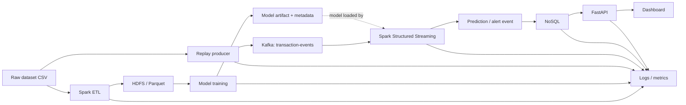

# Architecture v1 — Real-time Financial Fraud Detection

> Draft. The field mapping assumes a common PaySim CSV variant. Inspect the actual file header and documentation before closing decisions.

## Component contracts

| Component | Input | Output |
|---|---|---|
| Raw dataset | Source CSV | Preserved raw file and source metadata |
| Spark ETL | Raw CSV + config | Typed/validated DataFrame, quality summary |
| HDFS/Parquet | Raw/processed DataFrames | Durable raw/processed files |
| Model training | Processed labeled data | Model artifact, feature metadata, metrics |
| Replay producer | Source rows + transaction mapping | JSON events keyed by transaction ID |
| Kafka | Transaction events | `transaction-events` topic |
| Structured Streaming | Kafka JSON + model artifact | Scored prediction/alert events |
| NoSQL | Prediction/alert events | Idempotently stored/queryable records |
| API | NoSQL queries | JSON responses |
| Dashboard | API responses | Alert list, counts, risk/time trends |
| Logs/metrics | All services | Local logs, error counts, timings, throughput |

## Storage plan (local-first; no premature optimization)

- Raw dataset: `data/raw/`; preserve source file and document URL, retrieval date, checksum, and terms.
- Small synthetic fixtures: `data/sample/` and `samples/`; do not commit the full dataset.
- Local processed fallback: `data/processed/`.
- HDFS raw target: `hdfs:///fraud/raw/`.
- HDFS processed target: `hdfs:///fraud/processed/`.
- Model artifact: `artifacts/models/<model_version>/`, including model/pipeline and `metadata.json`.
- Streaming checkpoint: `data/checkpoints/streaming/<query_name>/` locally; use a durable configured path in deployment. Do not delete during restart tests.
- Logs: `logs/<service>.log`; avoid secrets and unnecessary sensitive values.
- Metrics/experiments: `reports/experiments/` as measured CSV/JSON/Markdown.
- Kafka data: broker-managed directory/volume.
- NoSQL data: database-managed volume/service; do not manipulate internal database files directly.

## Event-time proposal

For the common PaySim variant, `step` is a relative simulation step (commonly one hour), not a real-world timestamp. Proposed mapping: `event_time = configured_simulation_start_utc + step hours`, while preserving `event_time_step`. Confirm the source variant's documentation and units before implementation. The resulting timestamp is simulated, not actual wall-clock transaction time.

## Important limitations

PaySim is synthetic. Kafka replay simulates near-real-time ingestion; it is not a live bank feed. Exclude `isFraud` and `isFlaggedFraud` from the scoring event and model features unless a separate, justified offline use is documented. Do not claim end-to-end exactly-once processing until verified across the actual sink.
