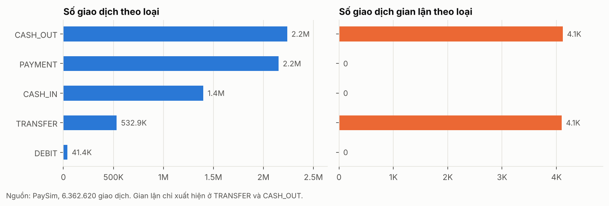
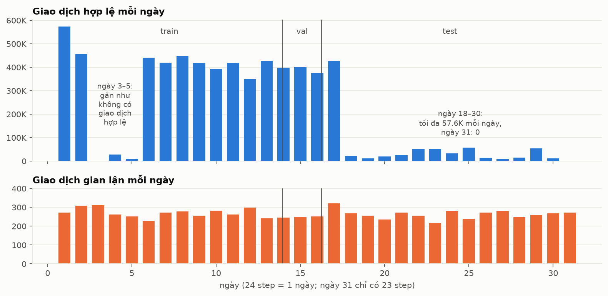
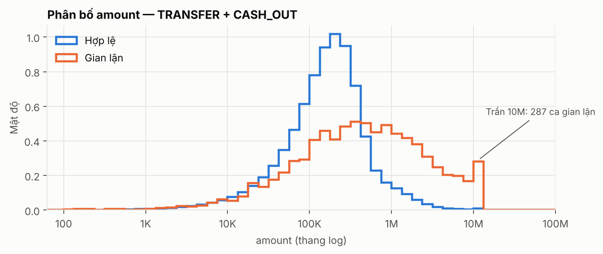
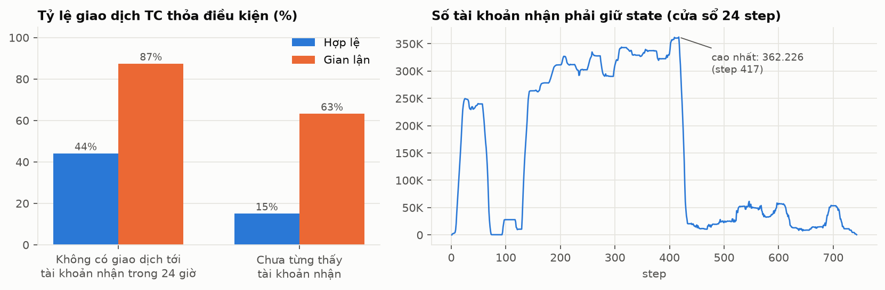
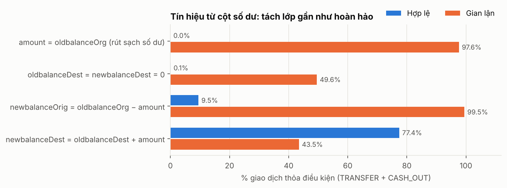
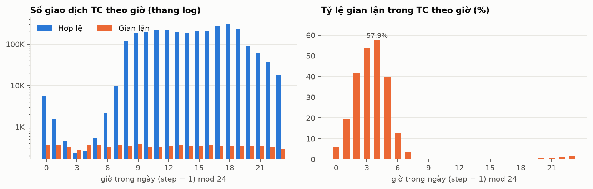
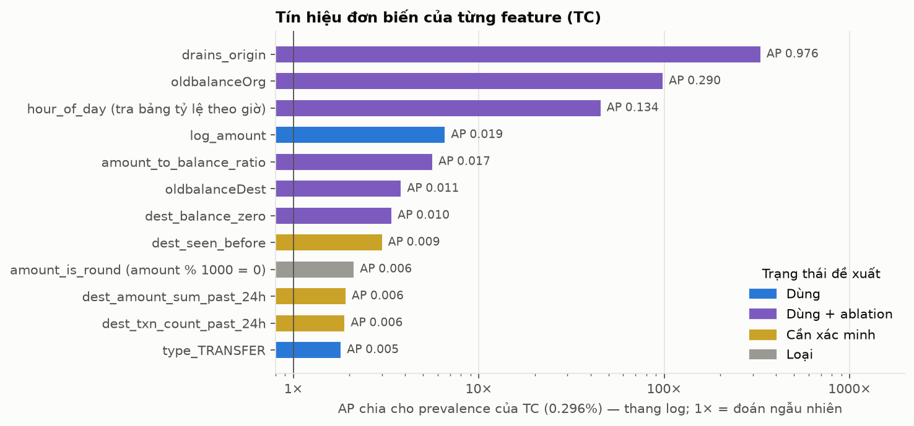
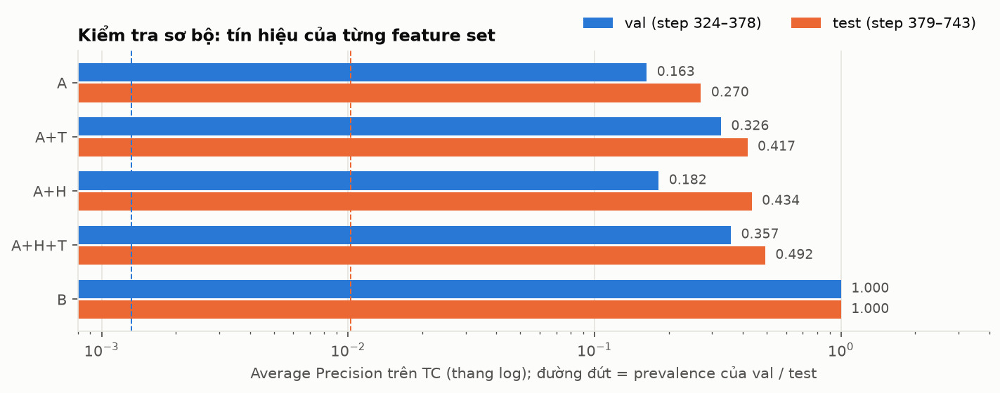

# EDA Report v1 — PaySim (W2)

**Owner:** Thái (Data & ML Evaluation) · **Trạng thái:** v1, chờ review · **Phạm vi:** 6.362.620 giao dịch, 8.213 gian lận
**Notebook:** `notebooks/w1_eda_label_evaluation.ipynb` (W1), `notebooks/w2_feature_draft_test_plan.ipynb` (W2) · **Số liệu:** `reports/eda_summary.json`, `reports/feature_analysis_summary.json`
**Đọc kèm:** `docs/label-definition.md`, `docs/feature-list.md`, `docs/feature-test-plan.md`, `docs/evaluation-plan.md`

## Tóm tắt

1. **Nhãn là `isFraud`**; `isFlaggedFraud` chỉ bật ở 16 dòng (recall 0,19%) nên chỉ làm baseline. Gian lận chiếm 0,129% (774 giao dịch hợp lệ cho mỗi giao dịch gian lận) và chỉ nằm ở TRANSFER (4.097) và CASH_OUT (4.116).
2. **Cột số dư là artifact của simulator.** `amount = oldbalanceOrg` thỏa ở 97,8% ca gian lận và 0% giao dịch hợp lệ; `oldbalanceOrg = 0` thỏa ở 47,4% giao dịch hợp lệ so với 0,30% gian lận. Mô hình có các cột này đạt AP ≈ 1,00.
3. **Không có số dư, tín hiệu thấp hơn nhiều.** Set A (type + amount) đạt AP 0,163/0,270 (val/test); bỏ vùng amount sát trần 10M còn 0,078/0,117, tức khoảng một nửa điểm AP dựa vào artifact trần.
4. **Trần 10M:** 2.443 giao dịch hợp lệ lớn hơn 10.000.000 và 0 gian lận; 3.207/3.271 giao dịch "tròn nghìn" bằng đúng 10M. `amount_is_round` bị loại.
5. **Tỷ lệ gian lận theo giờ là hệ quả của giao dịch hợp lệ.** Gian lận phẳng 3,3%–4,6% mỗi giờ; tỷ lệ 0,11%–57,9% chỉ vì giao dịch hợp lệ ban đêm co lại.
6. **Feature lịch sử theo tài khoản nhận có tín hiệu** (87,4% gian lận so với 44,1% hợp lệ không có giao dịch tới tài khoản nhận trong 24 giờ trước) nhưng cần state lớn và warm-up; `dest_is_merchant` trùng hoàn toàn với `type = PAYMENT`.
7. **Phân phối đổi mạnh theo thời gian:** giao dịch hợp lệ từ ~349.478–573.984 mỗi ngày xuống 8.298–57.613 từ ngày 18, gian lận đều ~216–320 mỗi ngày. Prevalence test (TC) cao gấp 5,5 lần train.
8. **Hệ quả:** event contract cần quyết định có thêm số dư hay không; streaming cần warm-up; quy tắc chọn threshold cần `min_precision`; W3 phải báo cáo đồng thời nhiều feature set. Chi tiết ở mục 9.

## 1. Dữ liệu và nguồn

| Mục | Giá trị |
|---|---|
| File | `paysim dataset.csv` (493.534.783 byte), 6.362.620 dòng, 11 cột |
| SHA-256 | `16910f90577b0d981bf8ff289714510bb89bc71bff7d3f220f024e287e4eea6b` |
| Đối chiếu | **Khớp** bản đã phân tích ở W1 (byte, SHA-256, số dòng); mọi số liệu W1 áp dụng nguyên vẹn |
| Tái lập W1 | Số dòng, số gian lận, số dòng/gian lận theo loại và theo split 323/378 đều khớp `eda_summary.json` |
| Chất lượng | Không null, không dòng trùng, không giá trị âm hoặc NaN; 9.073.900 tài khoản khác nhau (gửi và nhận) |
| Vị trí | File đang ở `data\paysim dataset.csv` (không phải `data\raw\`): chưa được `.gitignore` bỏ qua, đừng commit |

## 2. Nhãn và mất cân bằng

Kết quả W1, giữ nguyên: nhãn `isFraud`; `isFlaggedFraud` chỉ bật ở 16 dòng TRANSFER (đều là gian lận) trong khi rule mô tả khớp 409.110 dòng. Một "model" luôn đoán hợp lệ đạt accuracy 99,87%, vì vậy dùng PR-AUC, precision, recall, F1 và confusion matrix (xem `docs/evaluation-plan.md`).



## 3. Cấu trúc thời gian

`step` là giờ mô phỏng (1–743, ≈ 31 ngày; ngày 31 chỉ có 23 step). Gian lận đều đặn mỗi ngày; giao dịch hợp lệ thì không:



- Ngày 1–2 và 6–17: 349.478–573.984 giao dịch hợp lệ mỗi ngày. Ngày 3–5: 760, 27.978, 9.537. Ngày 18–30: 8.298–57.613. Ngày 31: 0.
- 320 step chỉ có giao dịch gian lận, rải khắp tháng (từ step 28), không nằm ở đuôi.
- Phân phối thay đổi theo ngày nên **không dùng `step` hoặc `day` thô làm feature** và phải đọc mọi metric kèm prevalence của đúng giai đoạn.

**Split theo thời gian (giữ nguyên đề xuất W1):**

| Split | Step | Số dòng (P1) | Gian lận | Prevalence P1 | Số dòng TC (P2) | Prevalence P2 |
|---|---|---|---|---|---|---|
| train | 1–323 | 4.463.587 | 3.643 | 0,082% | 1.951.895 | 0,187% |
| val | 324–378 | 980.416 | 564 | 0,058% | 427.991 | 0,132% |
| test | 379–743 | 918.617 | 4.006 | 0,436% | 390.523 | 1,026% |

Test chiếm 48,8% số ca gian lận trong 14,4% số dòng. Phương án phụ stratified random (seed 42) có prevalence 0,129% ở mọi phần nhưng không dùng được với feature lịch sử.

## 4. Loại giao dịch và `amount`

- Gian lận chỉ ở TRANSFER (tỷ lệ 0,77%) và CASH_OUT (0,18%). TC có 2.770.409 dòng (43,5%).
- `amount` nằm trong [0,01, 92.445.516,64] ngoài 16 dòng bằng 0 (đều là CASH_OUT gian lận); không âm, không NaN.
- **Trần 10M:** gian lận không bao giờ vượt 10.000.000 (W1: 287 ca đúng bằng 10M) trong khi 2.443 giao dịch hợp lệ (TC) lớn hơn. Mô hình cây có thể học "lớn hơn 10M ⇒ hợp lệ".



## 5. Tài khoản và feature lịch sử

- **Merchant:** 2.151.495 dòng tới tài khoản `M…`, đều là PAYMENT; không có dòng nào trong TC. `dest_is_merchant` ≡ `type = PAYMENT`.
- **Tài khoản gửi:** 6.353.307 giá trị trên 6.362.620 dòng; chỉ 9.298 tài khoản xuất hiện hơn một lần (0,29% số dòng) → không có lịch sử theo tài khoản gửi.
- **Vai trò chéo:** tài khoản nhận từng là tài khoản gửi ở 0,12% ca gian lận và 0,16% ca hợp lệ: không có tín hiệu.
- **Lịch sử theo tài khoản nhận:** 87,4% ca gian lận (so với 44,1% ca hợp lệ) tới tài khoản chưa có giao dịch nào trong 24 giờ trước; 63,3% (so với 15,1%) tới tài khoản chưa từng thấy.



**Hệ quả cho streaming** (đo trên dữ liệu thật): state tối đa 362.226 tài khoản cho cửa sổ 24 step và 2.722.362 cho `dest_seen_before`. Streaming khởi động nguội tại step 379 làm `dest_txn_count_past_24h` sai ở 20,9% dòng TC của 24 step đầu và `dest_seen_before` sai ở 48,7% dòng TC của cả giai đoạn test.

## 6. Số dư và leakage

Số dư *sau* giao dịch (`newbalanceOrig`, `newbalanceDest`) bị loại ở W1 vì chỉ biết sau khi giao dịch xử lý. Số dư *trước* giao dịch dùng được về mặt thời điểm nhưng là artifact mạnh (TC, amount > 0):

| Điều kiện | % gian lận | % hợp lệ | Số dòng |
|---|---|---|---|
| oldbalanceOrg = 0 | 0,30% | 47,37% | 1.308.566 |
| amount > oldbalanceOrg (rút quá số dư) | 0,35% | 90,10% | 2.488.634 |
| amount = oldbalanceOrg (so khớp chính xác) | 97,82% | 0,00% | 8.018 |
| \|amount − oldbalanceOrg\| < 0,005 (drains_origin) | 97,82% | 0,00% | 8.018 |
| \|amount − oldbalanceOrg\| ≤ 0,01 | 97,82% | 0,00% | 8.019 |
| oldbalanceDest = 0 (dest_balance_zero) | 65,21% | 13,90% | 389.314 |

- Giao dịch hợp lệ rút quá số dư (90,1%) là bất thường so với thực tế: gian lận trong simulator gần như luôn rút sạch tài khoản nạn nhân (97,8% số ca), còn giao dịch hợp lệ không bị ràng buộc bởi số dư.
- `drains_origin` dùng dung sai < 0,005 (nửa cent): dung sai 0,01 thêm đúng 1 dòng hợp lệ.
- 179 ca gian lận (amount > 0) không phải rút sạch, trong đó 145 ca có amount ≥ 10M.



## 7. Thời gian trong ngày



Mỗi giờ có 3,3%–4,6% tổng số ca gian lận (đều ~11 ca mỗi giờ), còn giao dịch hợp lệ trong TC từ 238 (giờ 3) đến 299.591 (giờ 18). Tỷ lệ gian lận 57,9% ở giờ 4 là hệ quả của mẫu số nhỏ, không phải gian lận tăng.

## 8. Sức mạnh tín hiệu của feature

**Đơn biến** (AP trên TC, so với prevalence 0,296%; mô tả toàn bộ dữ liệu, không phải đánh giá model):



| Feature | Chiều | AP | AP / prevalence | Trạng thái đề xuất |
|---|---|---|---|---|
| drains_origin | + | 0,976 | 329,3× | Dùng + ablation |
| oldbalanceOrg | + | 0,290 | 97,9× | Dùng + ablation |
| hour_of_day (tra bảng tỷ lệ theo giờ) | + | 0,134 | 45,2× | Dùng + ablation |
| log_amount | + | 0,019 | 6,5× | Dùng |
| amount_to_balance_ratio | − | 0,017 | 5,6× | Dùng + ablation |
| oldbalanceDest | − | 0,011 | 3,8× | Dùng + ablation |
| dest_balance_zero | + | 0,010 | 3,4× | Dùng + ablation |
| dest_seen_before | − | 0,009 | 3,0× | Cần xác minh |
| amount_is_round (amount % 1000 = 0) | + | 0,006 | 2,1× | Loại |
| dest_amount_sum_past_24h | − | 0,006 | 1,9× | Cần xác minh |
| dest_txn_count_past_24h | − | 0,006 | 1,9× | Cần xác minh |
| type_TRANSFER | + | 0,005 | 1,8× | Dùng |

**Theo feature set** (HistGradientBoosting có regularization, huấn luyện trên TC step 1–323, val = 324–378, test = 379–743; prevalence TC val 0,13%, test 1,03%). Đây là **kiểm tra sơ bộ**, không thay thế W3:



| Set | AP val | lift val | AP test | lift test | AP val (cấu hình phụ) | AP test (cấu hình phụ) |
|---|---|---|---|---|---|---|
| A | 0,163 | 124× | 0,270 | 26× | 0,162 | 0,271 |
| A+T | 0,326 | 247× | 0,417 | 41× | 0,334 | 0,424 |
| A+H | 0,182 | 138× | 0,434 | 42× | 0,180 | 0,432 |
| A+H+T | 0,357 | 271× | 0,492 | 48× | 0,368 | 0,523 |
| B | 1,000 | 759× | 1,000 | 97× | 1,000 | 1,000 |

- Tín hiệu của set A đến từ tương tác `type × amount` (riêng `log_amount`: 0,005/0,076; riêng `type`: 0,002/0,018). Bỏ 5.707 dòng amount ≥ 9,9M (chỉ 10/564 ca gian lận của val) làm AP còn 0,078/0,117.
- Kết quả **nhạy với cấu hình**; bảng dưới là bằng chứng và là lời nhắc cho W3:

| Cấu hình | Set | Số vòng thực tế | AP val | AP test |
|---|---|---|---|---|
| mặc định (early stopping tự động) | A | 11 | 0,008 | 0,057 |
| mặc định (early stopping tự động) | B | 15 | 0,991 | 0,999 |
| không regularization, 100 vòng | A | 100 | 0,112 | 0,241 |
| không regularization, 100 vòng | B | 100 | 0,006 | 0,036 |
| chính | A | 100 | 0,163 | 0,270 |
| chính | B | 100 | 1,000 | 1,000 |

## 9. Hệ quả cho feature list, split và đánh giá

| # | Phát hiện | Hệ quả | Văn bản |
|---|---|---|---|
| 1 | `dest_is_merchant` ≡ `type = PAYMENT` | Loại khỏi set A | `feature-list.md` AC6 |
| 2 | `amount_is_round` là trần 10M | Loại | TX4 |
| 3 | Nhóm số dư là artifact (AP ≈ 1,00) | Chỉ dùng như set B, luôn báo cáo kèm set A | mục 4 |
| 4 | Event contract chưa có số dư | Cần Lead và Công Anh quyết định thêm `*_balance_before` | mục 2, câu hỏi 6 |
| 5 | Feature lịch sử có tín hiệu nhưng cần state và warm-up | Set A+H "Cần xác minh"; replay có bước warm-up | mục 5.3 |
| 6 | `hour_of_day` dựa vào số giao dịch hợp lệ theo giờ | Chỉ vào biến thể A+T | TM1 |
| 7 | Prevalence và khối lượng giao dịch hợp lệ đổi mạnh theo ngày | Giữ split thời gian; đọc precision kèm prevalence từng split | mục 6 |
| 8 | Quy tắc chọn threshold W1 không có nhánh dự phòng thực sự | Thêm `min_precision` hoặc ngân sách alert; chốt `>=` | `evaluation-plan.md` v1.1 |
| 9 | Kết quả sơ bộ nhạy với cấu hình huấn luyện | W3 ghi rõ số vòng, regularization; không dựa vào early stopping mặc định | mục 8 |

**Quy tắc chọn threshold trên điểm số thật** (tập val, TC): quy tắc W1 "precision cao nhất với recall ≥ 0,80" cho set A alert 34,0% giao dịch TC (precision 0,31%); thêm `min_precision` = 0,05 (**chỉ để minh họa**, nhóm cần chốt giá trị) làm nhánh F2 hoạt động:

| Set | Quy tắc | Threshold | Precision | Recall | Số alert | % TC bị alert | Nhánh |
|---|---|---|---|---|---|---|---|
| A | W1: precision cao nhất, recall ≥ 0,80 | 0,0009 | 0,31% | 80,3% | 145.436 | 33,98% | max_precision_at_min_recall |
| A | đề xuất W2: thêm min_precision = 0,05 | 0,0345 | 34,49% | 17,6% | 287 | 0,07% | max_f2_fallback |
| A+T | W1: precision cao nhất, recall ≥ 0,80 | 0,0013 | 0,48% | 80,3% | 94.196 | 22,01% | max_precision_at_min_recall |
| A+T | đề xuất W2: thêm min_precision = 0,05 | 0,0582 | 47,99% | 33,9% | 398 | 0,09% | max_f2_fallback |
| A+H | W1: precision cao nhất, recall ≥ 0,80 | 0,0010 | 0,57% | 80,1% | 79.586 | 18,60% | max_precision_at_min_recall |
| A+H | đề xuất W2: thêm min_precision = 0,05 | 0,0959 | 12,25% | 22,2% | 1.020 | 0,24% | max_f2_fallback |
| A+H+T | W1: precision cao nhất, recall ≥ 0,80 | 0,0027 | 2,82% | 80,1% | 16.040 | 3,75% | max_precision_at_min_recall |
| A+H+T | đề xuất W2: thêm min_precision = 0,05 | 0,0988 | 26,18% | 43,3% | 932 | 0,22% | max_f2_fallback |
| B | W1: precision cao nhất, recall ≥ 0,80 | 0,9921 | 100,00% | 100,0% | 564 | 0,13% | max_precision_at_min_recall |
| B | đề xuất W2: thêm min_precision = 0,05 | 0,9921 | 100,00% | 100,0% | 564 | 0,13% | max_precision_at_min_recall |

## 10. Hạn chế

- Dataset là **mô phỏng**; nhiều tín hiệu mạnh (số dư, trần 10M, giờ trong ngày) là đặc tính của simulator. Kết quả không đại diện cho hiệu quả trên giao dịch ngân hàng thật.
- Phân tích thực hiện một lần trên toàn bộ dữ liệu bằng pandas; AP đơn biến mô tả dữ liệu, không phải ước lượng khả năng tổng quát.
- Kiểm tra feature set dùng scikit-learn `HistGradientBoostingClassifier`, không phải Spark MLlib của W3, và nhạy với cấu hình (mục 8).
- Các con số prevalence của val rất nhỏ (0,132% trong TC, 564 ca gian lận), nên precision/AP trên val có độ bất định lớn.

## Phụ lục: tái lập

```powershell
.\.venv\Scripts\Activate.ps1
cd notebooks
jupyter nbconvert --to notebook --execute --inplace w2_feature_draft_test_plan.ipynb
cd ..
python -m pytest tests/test_feature_reference.py -v
```
